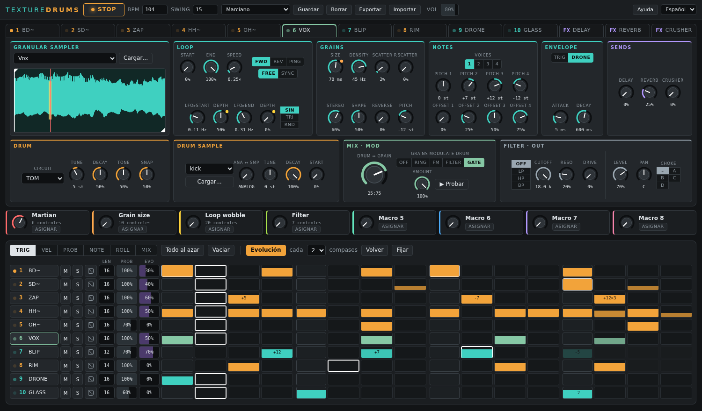

# TextureDrums — granular drum machine for the browser



Ten identical channels, each with a **drum voice** (a modelled analog circuit plus a sample) and a **granular sampler**, driven by a 10-track XOX sequencer with probabilities, randomising and slow pattern evolution. Eight macros move groups of controls at once. Static web app with no dependencies and no build step (AudioWorklet + Web MIDI).

**Try it online: <https://glopgar.github.io/texturedrums/>**

## Running it

```bash
python3 serve.py
```

Then open <http://localhost:8057/> in Chrome, Edge or Firefox. Audio needs `localhost` or HTTPS, so opening `index.html` as a file does not work.

```bash
node test/render.mjs
```

Offline engine tests: every drum circuit, the granular sampler (pitch, loop modes, loop LFOs, voices), the five modulation modes, sequencer timing, probabilities, rolls, choke groups, evolution, and every factory preset (each must sound, not clip, stay affordable and fall silent). `test/browser.mjs` drives the real panel in a headless browser if Playwright is available.

## Using it

- **Channel tabs** (top): the ten channels have the same controls. The tab colour shows what the channel is: amber = drum, teal = grains.
- **Granular sampler**: pick a source (built-in textures, any drum machine sample, or your own file with *Load…* or by dropping it on the waveform). The loop runs from START to END — forward, reverse or ping-pong, at SPEED (0 freezes it) — and each loop point has its own LFO. Drag the markers on the waveform. Up to four **notes** sound at once, each a stream of grains read from its own OFFSET into the loop and at its own PITCH. ENV on TRIG gives plucked notes; on DRONE the texture holds while the sequencer runs and the steps only change its pitch.
- **Drum**: twelve circuits (808 and 909 kick and snare, clap, hat, cymbal, tom, cowbell, rim, noise, FM) and a sample layer, blended with ANA ↔ SMP.
- **Mix · Mod**: DRUM ↔ GRAIN sets how much of each you hear. *Grains modulate drum* makes the drum alien: RING (grains multiply it), FM (grains bend its pitch), FILTER (grains move the filter cutoff), GATE (the drum's envelope lets the grains through).
- **Sequencer**: 10 tracks of up to 16 steps, all visible. TRIG / VEL / PROB / NOTE / ROLL choose the layer being edited: click and paint in TRIG (Shift+click = accent), drag up/down in the others, right-click resets a step. Each track has its own length (polymeters), probability and EVO amount, plus mute, solo and a dice for a random pattern.
- **Evolution**: with *Evolve* on, every 1–8 bars each track with EVO above zero changes a little (a hit slides, a ghost note appears, odds or notes shift) while staying close to the pattern you wrote. *Revert* brings your pattern back; *Keep* adopts the evolved one.
- **Macros**: press *Assign* on a macro and move controls — where each starts is the macro's minimum, where you leave it the maximum. Hold Alt to assign the same control on all ten channels. Right-click a control to remove it.
- **Controls**: drag up/down or use the wheel; Shift for fine adjustment; double-click resets. Keys: Space = play, `1…0` = select channel, `Q…P` = trigger channel. MIDI notes 36–45 trigger the channels, CC 70–77 move the macros.
- **Presets**: six factory presets plus save, export and import as JSON. The current state is restored on reload. Interface in Spanish or English.

## Structure

| File | Contents |
| --- | --- |
| `dsp/params.js` | The parameter list shared by engine, panel and tests |
| `dsp/drums.js` | Drum circuits and the one-shot sample layer |
| `dsp/grain.js` | Granular sampler: loop, loop LFOs, notes, grains |
| `dsp/engine.js` | Channels (mix, modulation, filter, sends), sequencer, master |
| `dsp/pattern.js` | Tracks, random patterns, evolution |
| `dsp/fx.js` | Ping-pong delay and reverb |
| `dsp/textures.js` | Built-in granular sources, computed from formulas |
| `dsp/wav.js` | WAV reader |
| `dsp/worklet.js` | AudioWorklet wrapper |
| `js/ui.js` | Widgets, tabs, channel panel, macros, waveform display |
| `js/seq.js` | Sequencer grid |
| `js/samples.js` | Sample pool; user samples are kept in IndexedDB |
| `js/presets.js` | Factory presets |
| `js/main.js` | Application state, audio start-up, presets, keyboard, MIDI |
| `samples/` | Drum machine samples and their credits |

## Samples

The CR-78, LinnDrum LM-2, Maestro Rhythm King MRK-2 and TR-505 kits are published as public domain in the [oramics/sampled](https://github.com/oramics/sampled) collection; sources are listed in `samples/README.md`. The textures (Glass, Strings, Vox, Bells, Wind, Radio) are generated by the app.
